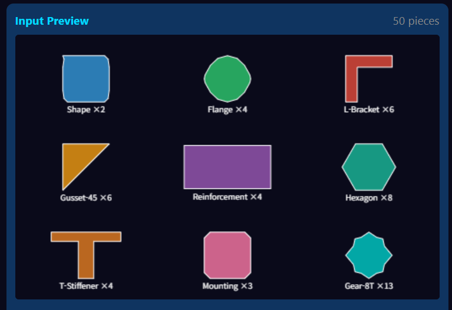
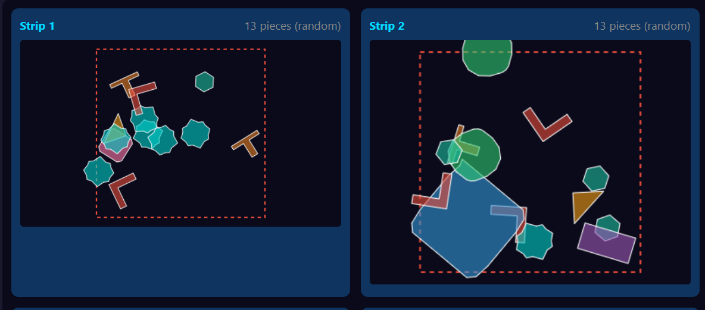
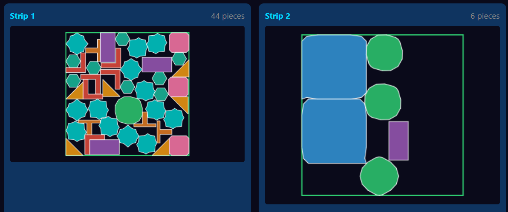
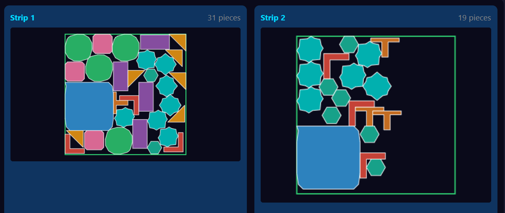
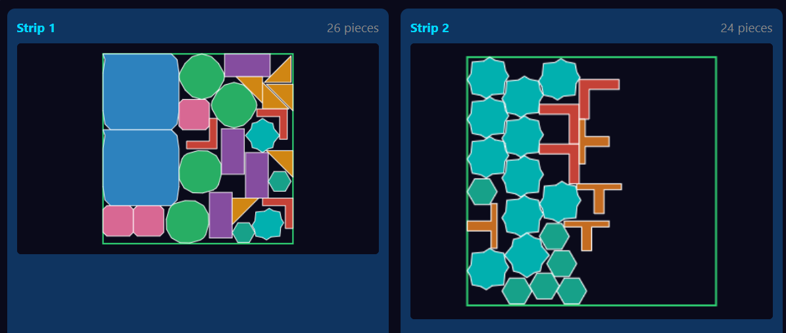
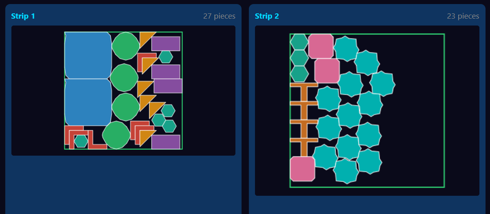
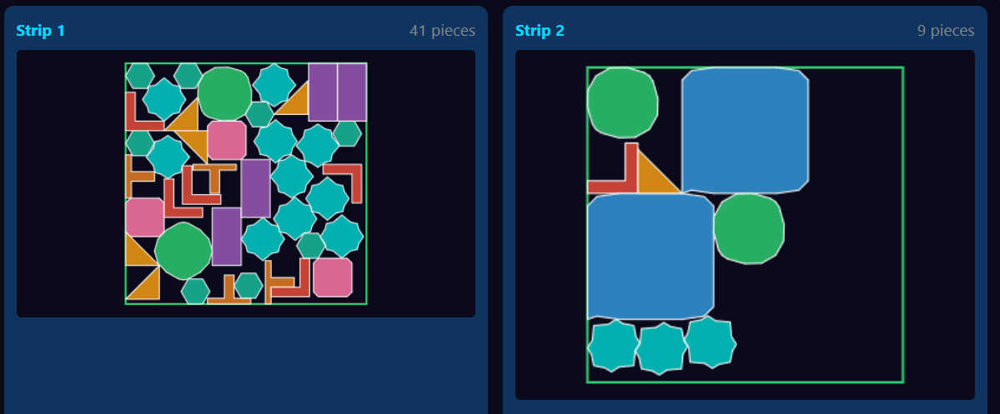
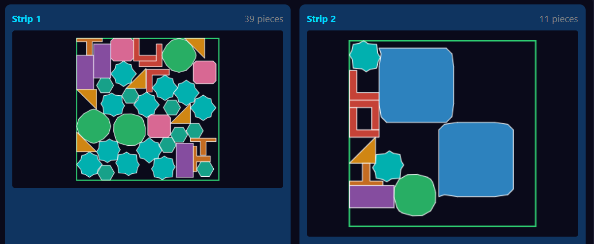
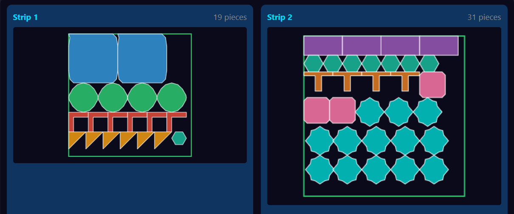

# U-Nesting

**2D/3D Spatial Optimization Engine** - High-performance nesting and bin packing algorithms in Rust with C FFI support

[](https://crates.io/crates/u-nesting)
[](https://docs.rs/u-nesting)
[](https://github.com/iyulab/U-Nesting/actions)
[](LICENSE)
[](https://www.rust-lang.org/)

<p align="center">
  
</p>

## Overview

U-Nesting provides domain-agnostic spatial optimization algorithms for 2D nesting and 3D bin packing problems:

- **2D Nesting** - Optimal polygon placement on bounded surfaces
- **3D Bin Packing** - Optimal volume arrangement in containers
- **Genetic Algorithm** - Metaheuristic optimization for complex layouts
- **NFP/NFR Computation** - Precise collision-free placement

### Design Philosophy

U-Nesting is a **pure computation engine** with no domain-specific logic. Industry context (manufacturing, textile, logistics, etc.) is determined by consuming applications.

```text
┌─────────────────────────────────────────┐
│         Consuming Applications          │
│  (Manufacturing, Textile, Logistics)    │
└─────────────────┬───────────────────────┘
                  │ Domain Context
                  ▼
┌─────────────────────────────────────────┐
│            U-Nesting Engine             │
│   Pure Geometry + Optimization Math     │
│      (Domain Agnostic)                  │
└─────────────────────────────────────────┘
```

## Features

- 🚀 **High Performance** - Written in Rust; the `parallel` feature evaluates GA/BRKGA populations and no-fit polygons on Rayon's thread pool
- 🎯 **Domain Agnostic** - Abstract models adaptable to any spatial optimization
- 📐 **2D Support** - Polygon nesting with NFP and holes (curves are supplied as polylines — flatten with a tolerance before submitting)
- 📦 **3D Support** - Box packing with physical constraints (gravity, stability, mass limits)
- 🔌 **C FFI Support** - Use from C#, Python, or any language with C bindings
- 📦 **Zero Domain Dependencies** - Pure mathematical optimization

## Demo

### Sample Dataset

A test dataset with **9 different polygon shapes** and **50 total pieces** on a 500×500 boundary:

<p align="center">
  
  
</p>

<p align="center">
  <em>Left: Original shapes | Right: Randomized input order</em>
</p>

### Algorithm Comparison

Optimization results using different algorithms on the same dataset (50 pieces, 500×500 boundary, 2 strips):

| Algorithm | Result | Utilization | Time |
|-----------|--------|-------------|------|
| **GA** (Genetic Algorithm) |  | **70.6%** | 19.5s |
| **GDRR** (Goal-Driven Ruin & Recreate) |  | 69.4% | 30.5s |
| **ALNS** (Adaptive Large Neighborhood Search) |  | 69.1% | 30.2s |
| **NFP** (No-Fit Polygon Guided) |  | 68.5% | 5.0s |
| **BRKGA** (Biased Random-Key GA) |  | 67.8% | 23.5s |
| **SA** (Simulated Annealing) |  | 64.1% | 34.3s |
| **BLF** (Bottom-Left Fill) |  | 60.0% | 338ms |

> **Note**: Higher utilization = better material efficiency. Results may vary depending on piece shapes, quantities, and constraints. Run your own benchmarks to find the best algorithm for your specific use case.
>
> These figures were captured before 0.11.0. Layouts and times differ from 0.11.0 on, which changed how placement follows the sheet's length, enforces `spacing` and `margin`, and honours `time_limit_ms`.

## Installation

### From crates.io

```toml
[dependencies]
u-nesting = "0.21"                                   # 2D + 3D (default features)
u-nesting = { version = "0.21", default-features = false, features = ["d2"] }  # 2D only
```

Features: `d2` and `d3` (default) select the dimensions, `cutting` adds cutting
path optimization for a 2D layout, `serde` serialization, and `parallel` runs a
search's population evaluation and the no-fit polygon computation on Rayon's
thread pool (without it a solve runs on the calling thread; bound the pool with
`rayon::ThreadPool::install` or `RAYON_NUM_THREADS`).

### From GitHub

```toml
[dependencies]
u-nesting = { git = "https://github.com/iyulab/u-nesting" }
```

## Quick Start

### 2D Nesting

```rust
use u_nesting::d2::{Boundary2D, Geometry2D, Nester2D};
use u_nesting::{Config, Solver, Strategy};

// Define geometries to place
let geometries = vec![
    Geometry2D::new("G1")
        .with_polygon(vec![(0.0, 0.0), (100.0, 0.0), (100.0, 50.0), (0.0, 50.0)])
        .with_quantity(5)
        .with_rotations_deg(vec![0.0, 90.0, 180.0, 270.0]),
];

// Define boundary
let boundary = Boundary2D::rectangle(1000.0, 500.0);

// Configure and run
let config = Config::new()
    .with_strategy(Strategy::NfpGuided)
    .with_spacing(3.0)
    .with_margin(10.0);

let result = Nester2D::new(config).solve(&geometries, &boundary).unwrap();
assert_eq!(result.placements.len(), 5);
println!("Utilization: {:.1}%", result.utilization * 100.0);
```

### 3D Bin Packing

```rust
use u_nesting::d3::{Boundary3D, Geometry3D, Packer3D};
use u_nesting::{Config, Solver, Strategy};

// Define geometries to place
let geometries = vec![
    Geometry3D::new("G1", 30.0, 20.0, 15.0)
        .with_quantity(10)
        .with_mass(2.5),
];

// Define boundary; gravity and stability are properties of the container
let boundary = Boundary3D::new(120.0, 80.0, 100.0)
    .with_max_mass(500.0)
    .with_gravity(true)
    .with_stability(true);

// Configure and run
let config = Config::new().with_strategy(Strategy::ExtremePoint);

let result = Packer3D::new(config).solve(&geometries, &boundary).unwrap();
assert_eq!(result.placements.len(), 10);
println!("Utilization: {:.1}%", result.utilization * 100.0);
```

## Core Concepts

| Concept | Description | 2D | 3D |
|---------|-------------|----|----|
| **Geometry** | Shape to be placed | Polygon | Box |
| **Boundary** | Containing region | Rectangle, Polygon | Box |
| **Placement** | Position + orientation | x, y, θ | x, y, z, rotation |
| **Spacing** | Minimum distance between two placed geometries | Float | Float |
| **Margin** | Minimum distance from a geometry to the boundary edge | Float | Float |
| **Constraint** | Placement rules | Rotation, Direction | Orientation, Stability |

## Module Structure

```text
u-nesting/
├── core/             # Shared abstractions
│   ├── geometry.rs   # Geometry, Boundary traits
│   ├── solver.rs     # Solver trait, Config, Strategy
│   ├── ga.rs, brkga.rs, sa.rs, gdrr.rs, alns.rs  # Search frameworks
│   ├── api_types.rs  # JSON request / response types
│   └── result.rs     # Unified result types
│
├── d2/               # 2D Module
│   ├── geometry.rs   # Polygon geometry (Geometry2D)
│   ├── boundary.rs   # 2D boundary definitions
│   ├── nfp.rs        # No Fit Polygon
│   ├── nester.rs     # Nester2D: placement and search strategies
│   └── *_nesting.rs  # GA, BRKGA, SA, GDRR, ALNS for 2D
│
├── d3/               # 3D Module
│   ├── geometry.rs   # Box (Geometry3D)
│   ├── boundary.rs   # 3D boundary definitions
│   ├── packer.rs     # Packer3D: placement and search strategies
│   ├── extreme_point.rs
│   └── physics.rs, stability.rs  # Gravity, stability
│
├── cutting/          # Cutting path optimization for a 2D layout
└── ffi/              # C FFI interface
```

## Algorithms

### 2D Algorithms

| Algorithm | Description | Quality | Speed |
|-----------|-------------|---------|-------|
| **BLF** (Bottom-Left Fill) | Greedy placement at bottom-left positions | ★★★☆☆ | ★★★★★ |
| **NFP** (No-Fit Polygon Guided) | NFP-based collision-free placement | ★★★★☆ | ★★★☆☆ |
| **GA** (Genetic Algorithm) | Sequence optimization with crossover/mutation | ★★★★★ | ★★☆☆☆ |
| **BRKGA** (Biased Random-Key GA) | Random-key encoding with elite inheritance | ★★★★★ | ★★☆☆☆ |
| **SA** (Simulated Annealing) | Temperature-based neighborhood search | ★★★★☆ | ★★★☆☆ |
| **GDRR** (Goal-Driven Ruin and Recreate) | Removes and re-inserts parts of the layout | ★★★★☆ | ★★★☆☆ |
| **ALNS** (Adaptive Large Neighborhood Search) | Destroy-repair with operator selection | ★★★★★ | ★★☆☆☆ |

### What the 2D heuristic and search strategies guarantee

BLF, NFP, GA, BRKGA, SA, GDRR and ALNS (the optional exact MILP strategies are
not covered here):

- **`spacing`** is the minimum distance between any two placed parts (it may be
  exceeded by at most 0.12 %, the allowance for rounded offsets). It does not
  apply to the boundary.
- **`margin`** is the minimum distance from any part to every boundary edge,
  including slanted edges of a polygon boundary and the edges of holes.
- Parts are placed inside the boundary polygon, never over a hole.
- Layouts advance along the boundary's longer side (the strip's length) and
  fill across the shorter one.
- **`time_limit_ms`** bounds the whole solve: the search strategies return the
  best layout found within it, plus the time of the bottom-left pass they are
  compared against.
- The search strategies (GA, BRKGA, SA, GDRR, ALNS) never return a layout that
  places fewer parts, or uses more length, than bottom-left fill on the same
  input — nor than greedy NFP placement, whenever that pass completes within
  the time limit (it runs first, inside the limit).

### 3D Algorithms

| Algorithm | Description | Quality | Speed |
|-----------|-------------|---------|-------|
| **Extreme Point** (`ep`) | Placement at extreme points | ★★★☆☆ | ★★★★★ |
| **Layer Packing** (`blf`) | Layer-based bottom-up placement | ★★★☆☆ | ★★★★☆ |
| **Genetic Algorithm** (`ga`) | Sequence and orientation optimization | ★★★★★ | ★★☆☆☆ |
| **BRKGA** (`brkga`) | Random-key encoding with elite inheritance | ★★★★★ | ★★☆☆☆ |
| **Simulated Annealing** (`sa`) | Temperature-based neighborhood search | ★★★★☆ | ★★★☆☆ |

## Configuration

### 2D Configuration

```rust
use u_nesting::{Config, Strategy};

// One `Config` serves 2D and 3D; every setting has a builder method.
let config = Config::new()
    .with_spacing(3.0)            // Minimum distance between geometries
    .with_margin(10.0)            // Minimum distance to the boundary edge
    .with_strategy(Strategy::GeneticAlgorithm)
    .with_time_limit(30_000)      // Whole solve, in milliseconds (0 = unlimited)
    .with_target_utilization(0.90)
    .with_seed(42);               // Reproducible runs
```

Rotation and mirroring are per geometry (`Geometry2D::with_rotations_deg`,
`with_flip`), not part of the configuration.

### 3D Configuration

```rust
use u_nesting::d3::geometry::OrientationConstraint;
use u_nesting::d3::{Boundary3D, Geometry3D};
use u_nesting::{Config, Strategy};

let config = Config::new()
    .with_margin(5.0)             // Boundary wall offset
    .with_strategy(Strategy::ExtremePoint)
    .with_time_limit(30_000);

// Physics lives on the container, orientation on each geometry.
let boundary = Boundary3D::new(120.0, 80.0, 100.0)
    .with_gravity(true)
    .with_stability(true);
let item = Geometry3D::new("crate", 30.0, 20.0, 15.0)
    .with_orientation(OrientationConstraint::Upright);
```

## FFI Interface

### JSON Request (2D)

```json
{
  "mode": "2d",
  "geometries": [
    {
      "id": "G1",
      "polygon": [[0,0], [100,0], [100,50], [0,50]],
      "quantity": 5,
      "rotations": [0, 90, 180, 270]
    }
  ],
  "boundary": { "width": 1000, "height": 500 },
  "config": { "spacing": 3.0, "strategy": "ga" }
}
```

### JSON Request (3D)

```json
{
  "mode": "3d",
  "geometries": [
    {
      "id": "G1",
      "dimensions": [30, 20, 15],
      "quantity": 10,
      "mass": 2.5
    }
  ],
  "boundary": {
    "dimensions": [120, 80, 100], "max_mass": 500,
    "gravity": true, "stability": true
  },
  "config": { "strategy": "ep" }
}
```

Gravity and stability are properties of the container (`boundary`), not of the
configuration. Every key a request takes is in the
[JSON schemas](docs/json-schema/README.md); a key the engine does not read is
refused (`malformed_input`), not ignored.

### C Interface

```c
// 2D or 3D by the request's "mode" ("2d" when absent).
int unesting_solve(const char* request_json, char** result_ptr);
int unesting_solve_2d(const char* request_json, char** result_ptr);
int unesting_solve_3d(const char* request_json, char** result_ptr);
void unesting_free_string(char* ptr);
```

The response is JSON with `success`, a stable `code` and `details` on a
refusal. The .NET package (`UNesting`) wraps this interface; see
[its README](bindings/csharp/README.md) and the
[FFI guide](docs/user-guide/ffi-integration.md).

## Result Structure

```text
SolveResult {
    placements: Vec<Placement>,   // Position + orientation for each placed instance
    boundaries_used: usize,       // Number of boundaries needed
    utilization: f64,             // Area/volume efficiency (0.0 - 1.0)
    unplaced: Vec<String>,        // Deduplicated IDs of geometries that couldn't fit
    total_requested: usize,       // Σ quantity; unplaced instances = total_requested - placements.len()
    computation_time_ms: u64,
}
```

## Performance

### 2D Benchmarks (GA)

| Geometries | Complexity | Time | Utilization |
|------------|------------|------|-------------|
| 20 | Simple | 200ms | 92% |
| 100 | Mixed | 2s | 88% |
| 500 | Complex | 15s | 85% |

### 3D Benchmarks (Extreme Point)

| Geometries | Complexity | Time | Utilization |
|------------|------------|------|-------------|
| 50 | Uniform | 100ms | 85% |
| 200 | Mixed | 1.5s | 78% |
| 100 | Constrained | 3s | 72% |

## Architecture

```text
┌──────────────────────────────────────────────┐
│              U-Nesting Engine                │
├──────────────────────────────────────────────┤
│  Core: Traits, GA Framework, Config          │
├─────────────────────┬────────────────────────┤
│     2D Module       │       3D Module        │
├─────────────────────┼────────────────────────┤
│  Polygon, NFP       │  Box, NFR              │
│  BLF, GA Nester     │  EP, LAFF, GA Packer   │
└─────────────────────┴────────────────────────┘
          ▲                    ▲
          │                    │
┌─────────┴────────────────────┴───────────────┐
│           Consuming Applications             │
│  ┌─────────┐ ┌─────────┐ ┌─────────┐        │
│  │  Sheet  │ │  Mold   │ │Container│  ...   │
│  │  Metal  │ │  Design │ │ Loading │        │
│  └─────────┘ └─────────┘ └─────────┘        │
└──────────────────────────────────────────────┘
```

## License

Licensed under either of:

- MIT license ([LICENSE](LICENSE))

## Contributing

Contributions are welcome! Please read [CONTRIBUTING.md](CONTRIBUTING.md) for guidelines.

## Related

- [u-numflow](https://github.com/iyulab/u-numflow) — Mathematical primitives
- [u-metaheur](https://github.com/iyulab/u-metaheur) — Metaheuristic optimization (GA, SA, ALNS, CP)
- [u-geometry](https://github.com/iyulab/u-geometry) — Computational geometry
- [u-schedule](https://github.com/iyulab/u-schedule) — Scheduling framework